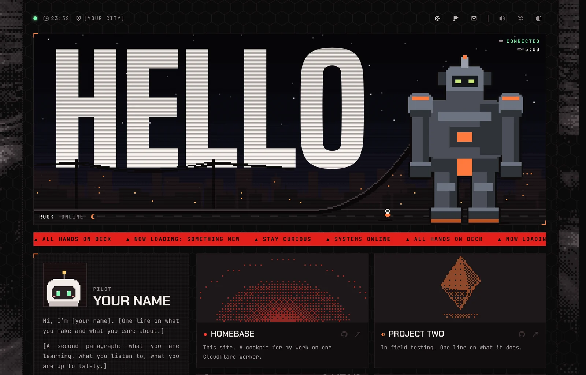
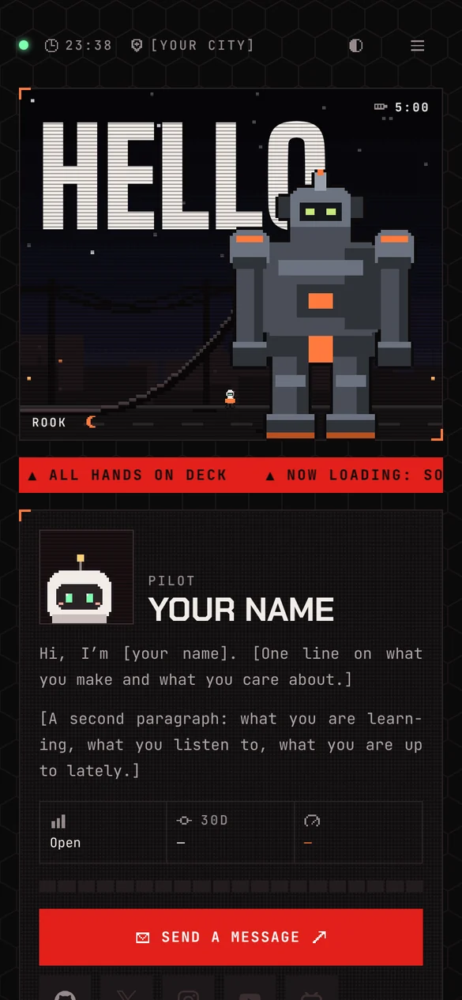
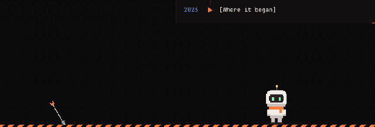

<div align="center">

<picture>
  <source media="(prefers-color-scheme: light)" srcset="docs/preview-light.webp">
  
</picture>

# Asuki Template

**A pixel-art cockpit for your homepage. Bring a character, let an AI do the rest.**

The framework behind [asuki.cc](https://asuki.cc), with every personal asset taken out.<br>
Swap one folder and it becomes yours: your mech in the banner, your pet on the caution tape, your music, your words.

[](https://astro.build)
[](https://developers.cloudflare.com/workers/)
[](#how-it-is-built)
[](LICENSE)

[Make it yours](#make-it-yours-with-ai) · [What is in it](#what-is-in-it) · [Run it](#run-it) · [Deploy](#deploy-to-cloudflare) · [The persona](PERSONA.md)

</div>

---

## What is in it

<table>
<tr>
<td width="62%" valign="top">

- **A living banner.** A pixel city whose sky follows the real time of day and weather where you live: dawn, dusk, rain, fog, snow, lightning. A giant mech stands in the street, plugged in by a power cable.
- **Things to poke.** Click the sky and a shield flares up. Pull the cable and the mech runs down its battery while its tiny pilot hurries to plug it back in. Hold the mech and it strains toward an Easter egg, if you give it one.
- **A pet in the footer.** It wanders the caution tape, looks at your cursor, likes being stroked, sulks when you overdo it, and throws its prop down the tape when you hand it over.
- **The rest of a homepage.** Profile with live GitHub stats, project cards with generated pixel machines, a year of contributions, milestones, your tools, a music player and social cards.
- **Physics, not tracks.** Springs, ropes and thrown objects are simulated, so nothing moves the same way twice.
- **Light and dark**, phone and desktop, reduced-motion aware, and synthesised sound you can switch off.

</td>
<td width="38%" valign="top" align="center">



</td>
</tr>
</table>

<div align="center">

<br><sub>Bit, the example pet: petted, then handed the harpoon.</sub>
</div>

## Make it yours with AI

Everything that makes the site someone's lives in one folder, `persona/`. The framework never names a character, a song or a person. So you can hand the repo to an AI coding agent (Claude Code, Codex, Cursor, Copilot) and have it build your persona, while the code stays the same.

The repo is set up for that: [`AGENTS.md`](AGENTS.md) tells the agent the house rules, [`PERSONA.md`](PERSONA.md) is the exact format, and `npm run check` tells it in plain words what is wrong.

**1. Start your persona**

> Read AGENTS.md and PERSONA.md. Copy persona/example to persona/&lt;my-name&gt; and make it mine: the site is called "&lt;name&gt;", the banner says "&lt;WORD&gt;", I live in &lt;city&gt;, my GitHub is &lt;login&gt;. Write my bio, projects and links into content.ts. Run npm run check until it passes.

**2. Draw your characters**

> Here is my character: &lt;attach images&gt;. Make a pixel-art pet from it, about 50 x 70 cells, in the same palette-row format as persona/example/sprites/pet.json, with every pose in PET_FRAMES. Then a mech for the banner (about 70 x 100) and a tiny pilot (about 20 x 20). Keep the palette under 16 colours.

Prefer to draw them yourself? Draw at one pixel per cell in any pixel editor (Aseprite, Piskel, Photoshop), export PNGs, and convert:

```sh
npm run sprite -- art/idle.png art/blink.png art/side.png --out persona/<name>/sprites/pet
```

**3. Give it a voice**

> Write my pet's lines in persona/&lt;name&gt;/index.ts and content.ts: shy but proud. Change the interface words to fit a &lt;submarine / spaceship / steampunk&gt; theme, and give the site a &lt;blue&gt; accent in theme.css.

Add music with `npm run peaks -- persona/<name>/public/music/<file>.mp3`, which prints the player's waveform for you to paste in.

> [!IMPORTANT]
> Only use art, music and characters you have the right to publish. The framework adds nothing that needs a licence; what you put in `persona/` is yours to sort out. Keep your persona in a **private** repository if any of it is licensed to you alone.

## Run it

You need Node 22 or later.

```sh
npm install
cp .dev.vars.example .dev.vars   # optional: add a GITHUB_TOKEN for the real contribution graph
npm run dev                      # quickest for styling, at http://localhost:4321
npm run preview                  # the real Worker with a local database, at http://localhost:8787
```

Which persona is used: the one folder in `persona/` that is not `example`, or `example` if there is none. With several, pick one with `PERSONA=<name> npm run dev`.

## Deploy to Cloudflare

<details>
<summary><b>Workers Builds: push to GitHub, Cloudflare builds and deploys</b></summary>

1. **Set your details** in `wrangler.jsonc`: the Worker's `name`, `GITHUB_USER`, `LOCATION_LABEL`, `TIMEZONE`, `LAT` and `LON`, and any social accounts you want on the cards. Push.
2. **Connect the repo.** In the Cloudflare dashboard: Workers & Pages, Create, Import a repository.
   - Build command: `npm run build`
   - Deploy command: `npx wrangler deploy`

   The first deploy creates the D1 database by itself, and the Worker creates its own tables and your starting content the first time it runs. There is no migration step.
3. **Add secrets** under the Worker's Settings, Variables and Secrets:
   - `GITHUB_TOKEN`: a fine-grained token with read-only access to public repositories. It reads your contribution calendar.
   - `VISIT_SALT`: any long random string (`openssl rand -hex 32`). Visitors are counted once a day by a salted hash, and no IP is stored.
   - Optional: `YOUTUBE_KEY`, `INSTAGRAM_TOKEN` for richer social cards.
4. **Your domain.** Once it is on your Cloudflare account, uncomment `routes` in `wrangler.jsonc`.

Every push to the default branch redeploys. An hourly cron keeps the GitHub and weather data warm, so no visitor waits for them.

</details>

<details>
<summary><b>Edit content after launch: the admin API</b></summary>

`content.ts` is only the starting content. After the first run, everything on the page (bio, ticker, projects, milestones, tools, links, pet lines) lives in D1 and is edited through `/admin/*`, which is built for a dashboard to drive.

Protect it with Cloudflare Access: create a self-hosted application for the path `/admin` on your domain, then put the team name and the Audience tag in `wrangler.jsonc` as `ACCESS_TEAM` and `ACCESS_AUD`. The Worker checks Access's signed token itself as well, so if Access is missing or wrong, the admin API stays closed.

| Method | Path | What it does |
|---|---|---|
| GET | `/admin/manifest` | The collections, their fields and the actions; a dashboard builds its forms from this |
| GET | `/admin/c/:collection` | List rows |
| POST · PATCH · DELETE | `/admin/c/:collection[/:id]` | Create, update, delete. Updates send `If-Match: <updated_at>` |
| POST | `/admin/actions/:name` | `refresh-github`, `refresh-weather`, `reset-counter` |
| GET | `/admin/health`, `/admin/stats`, `/admin/audit` | Status, counts, and who changed what |

Locally, `ADMIN_DEV_BYPASS=1` in `.dev.vars` opens it on `localhost` only.

</details>

## How it is built

```
persona/
  example/              the persona this template ships with: Bit, Rook and a harpoon. Copy it.
    index.ts            names, sprites, words, music, sounds, Easter egg
    content.ts          the starting bio, projects, links, ticker and pet lines
    theme.css           colour overrides
    sprites/            pixel art as palette rows
    public/             favicon, pictures, music, sound effects
src/
  pages/index.astro     the page
  components/           the banner, profile panel, modules and footer
  scripts/              the browser side: small state machines, springs, ropes, canvases
  lib/persona.ts        the persona's type: what a persona must provide
  server/               D1 schema, GitHub and weather snapshots, public and admin API
  worker.ts             the Worker: routes, page cache, hourly cron
scripts/                check-persona, sprite-from-png, peaks, and the build helpers
```

Astro renders the page on one Cloudflare Worker, with D1 for content and counters. There is no framework on the client: each interaction is a small TypeScript state machine, stepped only while it is on screen.

## License

The code is [MIT](LICENSE). The example persona (Bit, Rook, the pilot, the harpoon and the favicon) is original and under the same license, so you can reuse or remix it.
