<div align="center">


# Asuki Template

**A pixel-art cockpit for your homepage. Bring a character, and let an AI do the rest.**

English · [简体中文](README.zh-CN.md)

[](https://astro.build)
[](https://developers.cloudflare.com/workers/)
[](#how-it-is-built)
[](AGENTS.md)
[](LICENSE)

[Tour](#a-tour) · [Make it yours with AI](#make-it-yours-with-ai) · [Run it](#run-it-on-your-computer) · [Deploy](#deploy-to-cloudflare) · [Edit after launch](#edit-content-after-launch) · [Persona format](PERSONA.md)

<picture>
  <source media="(prefers-color-scheme: light)" srcset="docs/hero-light.webp">
  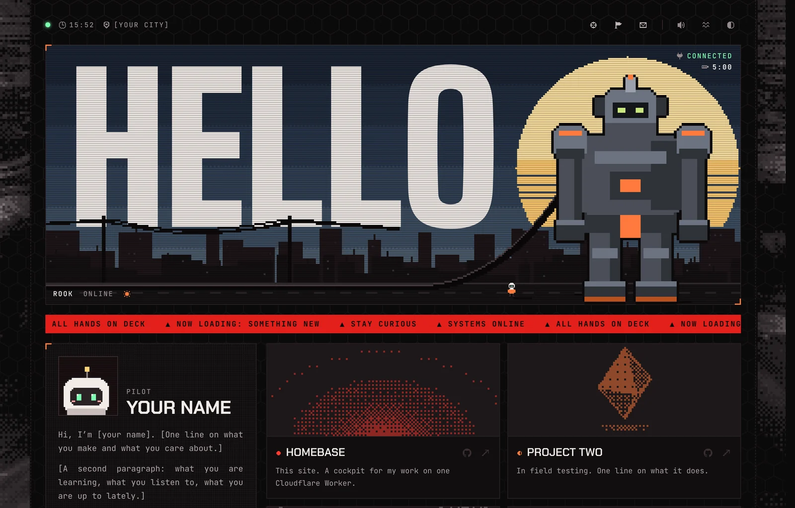
</picture>

</div>

This is the framework behind [asuki.cc](https://asuki.cc), with every personal asset taken out. Everything that makes the site someone's lives in one folder, `persona/`. Swap that folder and the site becomes yours: your mech in the banner, your pet on the caution tape, your music and your words. The code stays the same.

It ships with an original example persona: **Rook** the mech, **Bit** the pet, a tiny pilot and a harpoon. They are MIT-licensed, so you can keep them, remix them or replace them.

## Contents

- [What is in it](#what-is-in-it)
- [A tour](#a-tour)
- [Make it yours with AI](#make-it-yours-with-ai)
- [Make it yours by hand](#make-it-yours-by-hand)
- [Run it on your computer](#run-it-on-your-computer)
- [Deploy to Cloudflare](#deploy-to-cloudflare)
- [Edit content after launch](#edit-content-after-launch)
- [Settings reference](#settings-reference)
- [How it is built](#how-it-is-built)
- [Questions](#questions)
- [License](#license)

## What is in it

<table>
<tr>
<td width="60%" valign="top">

- **A living banner.** A pixel city whose sky follows the real time of day and weather where you live: dawn, day, dusk, night, rain, fog, snow and lightning. A giant mech stands in the street, plugged in by a power cable.
- **Things to poke.** Click the sky and a shield flares up. Pull the cable and the mech runs on its battery while the pilot hurries to plug it back in. Hover over the mech and its eyes glow. Hold it for two seconds to open an Easter egg, if you give it one.
- **A pet in the footer.** It wanders along the caution tape, watches your cursor, likes being stroked, and sulks if you overdo it. Hand it its prop and it throws it down the tape.
- **The rest of a homepage.** A profile with live GitHub stats, project cards with generated pixel machines, a year of contributions, milestones, your tools, a music player and social cards with live counts.
- **Physics, not fixed paths.** Springs, ropes and thrown objects are simulated, so nothing moves the same way twice.
- **Light and dark themes**, phone and desktop layouts, reduced-motion support, and synthesised sound you can switch off.
- **Fast.** The page is rendered on the edge and cached. GitHub and weather data are refreshed every hour in the background, so no visitor waits for them.

</td>
<td width="40%" valign="top" align="center">

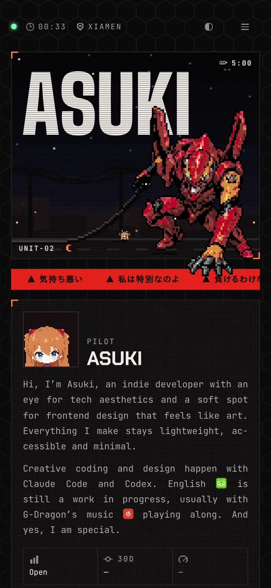 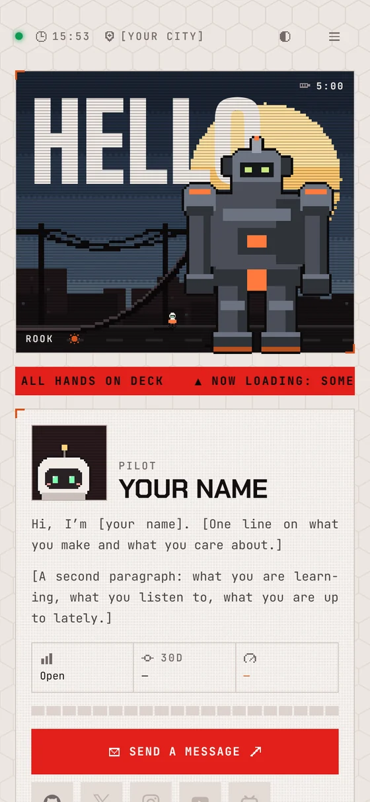

</td>
</tr>
</table>

## A tour

### The sky follows yours

Set your latitude and longitude, and the banner shows your real sky: the sun's height, the time of day and the current weather, from [Open-Meteo](https://open-meteo.com) (free, no key). Clouds, rain, snow, fog and lightning are drawn in the same pixel grid as the art.

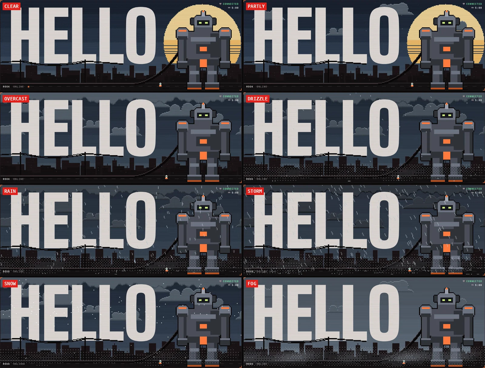

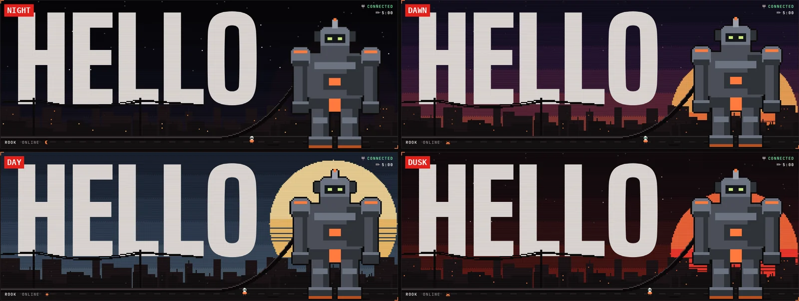

You can preview any weather with `?weather=rain` (or `clear`, `partly`, `overcast`, `fog`, `drizzle`, `storm`, `snow`).

### Pull the plug

The power cable is a simulated rope. Pull it and the mech switches to a five-minute battery while the pilot runs over and plugs it back in. Pull it three times in a row and the pilot sulks, and the battery may run dry.

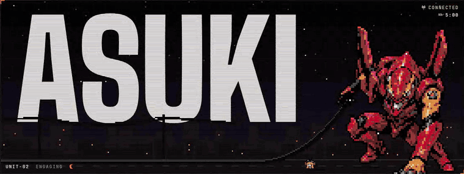

### Raise a shield

Click anywhere in the sky and a shield flares up where you clicked, with its own sound. The pilot looks up.

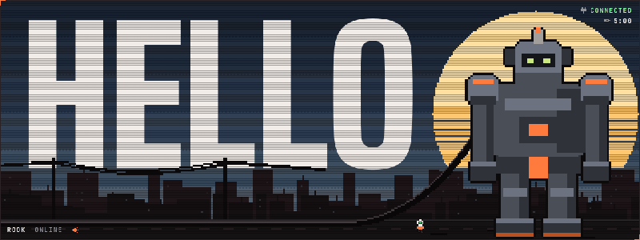

### Pet the pet

Stroke the pet back and forth to pet it. It says one of its lines, and gets cross if you keep going. Pick up its prop and drop it on the pet (or focus the prop and press Enter), and the pet raises it, winds up and throws it. You can throw the prop yourself too: it flies like a javelin, keeps the spin your hand gave it and sticks in the tape tip first.

<div align="center">

</div>

### Projects and milestones

The project cards open a full page: a turning shelf of cases, each with a pixel machine generated from the project's name, its state, links and an optional video. Milestones get a timeline with one entry per moment that mattered.

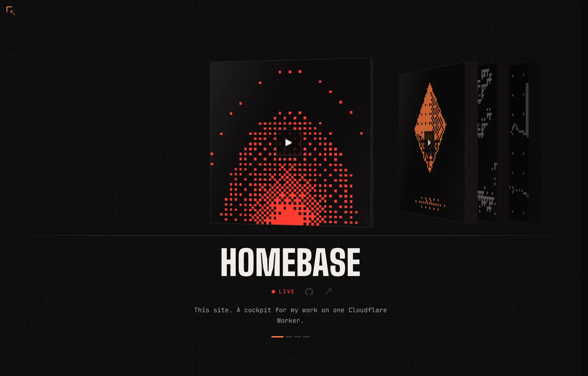

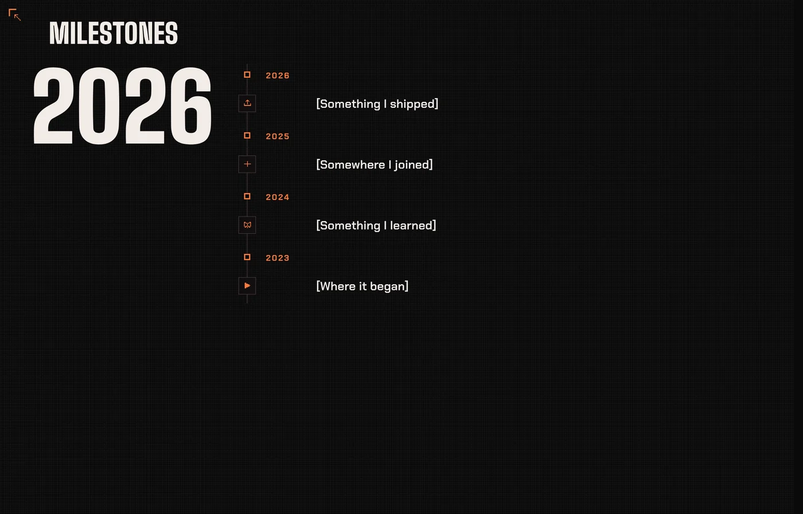

### The whole page, in both themes

<table>
<tr>
<td width="50%">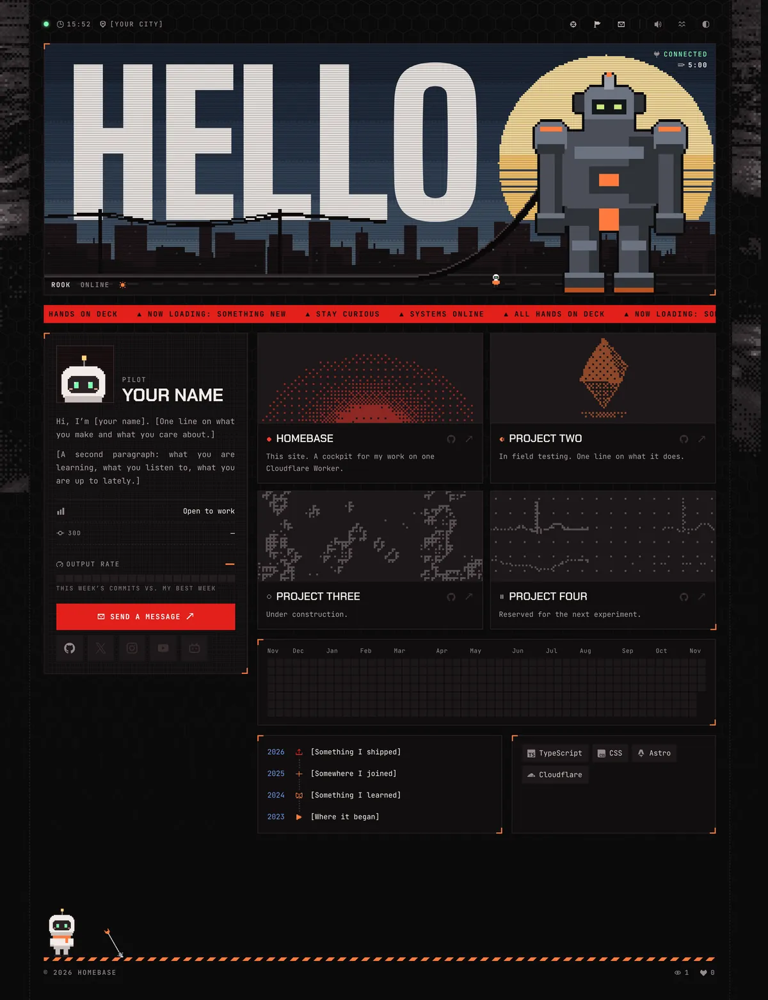</td>
<td width="50%">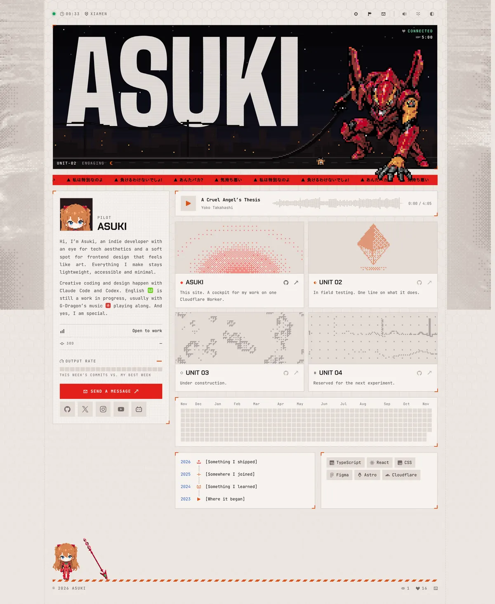</td>
</tr>
</table>

## Make it yours with AI

The framework never names a character, a song or a person, so you can hand the repo to an AI coding agent (Claude Code, Codex, Cursor, Copilot, Windsurf...) and have it build your persona while the code stays as it is.

The repo is set up for this:

| File | What it gives the agent |
|---|---|
| [`AGENTS.md`](AGENTS.md) (and `CLAUDE.md`) | The house rules: change the persona, not the framework; run the check after every change; where accounts and secrets go |
| [`PERSONA.md`](PERSONA.md) | The exact format: sprite rows, pose names, anchors, content fields and limits |
| `src/lib/persona.ts` | The persona's type, with a comment on every field |
| `npm run check` | A validator that says in plain words what is wrong and where |

Open the repo in your agent and paste these prompts one at a time. Replace the parts in `<angle brackets>`.

**1. Start your persona**

> Read AGENTS.md and PERSONA.md. Copy persona/example to persona/&lt;my-name&gt; and make it mine: the site is called "&lt;name&gt;", the banner says "&lt;WORD&gt;", I live in &lt;city&gt;, and my GitHub is &lt;login&gt;. Put my location and accounts in wrangler.jsonc. Write my bio, projects and links into content.ts. Run npm run check until it passes.

**2. Draw your characters**

> Here is my character: &lt;attach images&gt;. Make a pixel-art pet from it, about 50 x 70 cells, in the same palette-row format as persona/example/sprites/pet.json, with every pose listed in PET_FRAMES. Then make a mech for the banner (about 70 x 100) and a tiny pilot (about 20 x 20). Keep each palette under 16 colours. Update the anchors (feet, socket, shadows, eyes, hands, head) to match the new art, and run npm run check.

This is everything the example persona draws. Your agent draws the same set for your character:

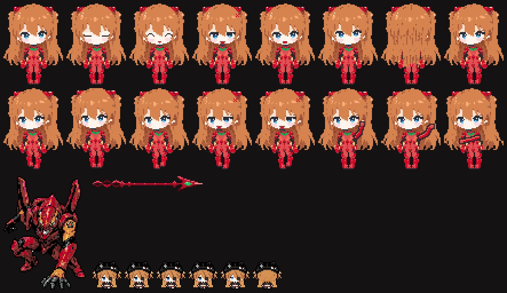

**3. Give it a voice and a colour**

> Write my pet's lines in persona/&lt;name&gt;/index.ts and content.ts: shy but proud. Change the interface words to fit a &lt;submarine / spaceship / steampunk&gt; theme, and give the site a &lt;blue&gt; accent in theme.css, for both themes.

**4. Add music and sound (optional)**

> Add persona/&lt;name&gt;/public/music/&lt;file&gt;.mp3 as the music player's track: run npm run peaks on it and paste the result into index.ts. Use persona/&lt;name&gt;/public/sfx/&lt;file&gt;.mp3 as the shield sound.

**5. Add an Easter egg (optional)**

> Make an Easter egg for persona/&lt;name&gt;: when the mech is held for two seconds, show &lt;what you want&gt; over the page. Follow the egg section of PERSONA.md and keep the SSR check.

**6. Check it**

> Run npm run build and npm run preview, open http://localhost:8787, and tell me what looks wrong.

> [!TIP]
> Agents draw best when they work row by row on a grid with a small palette, and when each pose is a small change to the idle pose. AGENTS.md already tells them this. If your agent can see images, ask it to render the sprites to PNG and look at them before finishing.

> [!IMPORTANT]
> Only use art, music and characters you have the right to publish. The framework adds nothing that needs a licence; what you put in `persona/` is yours to sort out. Keep your persona in a **private** repository if any of it is licensed to you alone.

## Make it yours by hand

A persona is one folder:

```
persona/<name>/
  index.ts        names, sprites, words, music, sounds, Easter egg   (required)
  content.ts      the starting content of the database               (required)
  theme.css       colour overrides; may be empty                     (required)
  sprites/        pixel art, as JSON
  public/         files served at the site root: favicon.svg, img/, music/, sfx/
```

1. Copy `persona/example` to `persona/<name>`. With one folder besides `example`, that folder is used automatically.
2. Edit `index.ts`: `name` (the site's name), `title` (the word across the sky, 5 or 6 capitals fit), `url`, and the names and words.
3. Edit `content.ts`: bio, status, ticker, projects, milestones, tools, links and pet lines.
4. Draw your sprites in any pixel editor (Aseprite, Piskel, LibreSprite, Photoshop) at one pixel per cell, export PNGs and convert them:

   ```sh
   npm run sprite -- art/idle.png art/blink.png art/side.png --out persona/<name>/sprites/pet
   ```

   The first file becomes the sprite and the others become poses named after their files. Add `--cell 4` for art drawn in 4 x 4 blocks.
5. Run `npm run check`. It checks every rule in [PERSONA.md](PERSONA.md): row widths, colours, pose sizes, anchors inside the art, field limits, and files that exist. It prints what to fix, for example:

   ```
   persona: persona/bob
     ✗ mech.socket [90, 28] is outside the 64 x 96 sprite
     ✗ pet.frames.sideB: must be 40 x 54 cells like the sprite

   2 problem(s) to fix.
   ```

## Run it on your computer

You need [Node.js](https://nodejs.org) 22 or later.

```sh
git clone https://github.com/<you>/<your-repo>.git
cd <your-repo>
npm install
cp .dev.vars.example .dev.vars   # optional: add a GITHUB_TOKEN for the real contribution graph
npm run dev                      # the quickest for styling, at http://localhost:4321
```

| Command | What it does |
|---|---|
| `npm run dev` | Checks the persona, then starts the dev server at http://localhost:4321. Pages reload as you edit. |
| `npm run preview` | Builds, then runs the real Worker with a local D1 database at http://localhost:8787. Use this to try the counters, the admin API and the cron. |
| `npm run check` | Checks the persona in use |
| `npm run build` | Checks, then builds into `dist/` |
| `npm run deploy` | Builds and deploys with Wrangler from your computer |
| `npm run sprite -- <png...> --out <path>` | Converts PNGs to sprite JSON |
| `npm run peaks -- <mp3>` | Prints the music player's track block, with its waveform (needs [ffmpeg](https://ffmpeg.org)) |

Which persona is used: `PERSONA=<name>` if it is set, otherwise the only folder in `persona/` that is not `example`, otherwise `example`. With several personas, pick one with `PERSONA=<name> npm run dev`.

## Deploy to Cloudflare

Everything runs on Cloudflare's free plan: one Worker and one D1 database.

**1. Fill in your details** in `wrangler.jsonc` and push them to GitHub:

- `name`: the Worker's name, which is also your `*.workers.dev` subdomain
- `GITHUB_USER`, `LOCATION_LABEL`, `TIMEZONE`, `LAT`, `LON`
- any social accounts you want on the cards (see [Settings reference](#settings-reference))

**2. Connect the repo.** In the [Cloudflare dashboard](https://dash.cloudflare.com), go to Workers & Pages, then Create, then Import a repository, and pick your repo.

- Build command: `npm run build`
- Deploy command: `npx wrangler deploy`
- Root directory: `/`

The first deploy creates the D1 database by itself. The Worker creates its own tables and your starting content the first time it runs, so there is no migration step.

**3. Add the secrets** under the Worker's Settings, then Variables and Secrets (type: Secret):

| Secret | What it is for |
|---|---|
| `GITHUB_TOKEN` | A [fine-grained token](https://github.com/settings/personal-access-tokens) with public repositories, read-only, and no other permissions. It reads your contribution calendar. |
| `VISIT_SALT` | Any long random string, for example from `openssl rand -hex 32`. Visitors are counted once a day by a salted hash, and no IP address is stored. |
| `YOUTUBE_KEY` | Optional. A Google Cloud API key with only the YouTube Data API v3, for the YouTube card's subscriber count. |
| `INSTAGRAM_TOKEN` | Optional. For the Instagram card, if you don't use Behold (see below). |

**4. Use your own domain.** Once the domain is on your Cloudflare account, uncomment `routes` in `wrangler.jsonc` and push. You can also add it under the Worker's Settings, then Domains & Routes.

Every push to your default branch rebuilds and redeploys the site. The hourly cron (`7 * * * *`) keeps the GitHub and weather data fresh.

> [!NOTE]
> Plain variables live in `wrangler.jsonc`, and a deploy replaces any plain variable you set in the dashboard, so change them in the file. Secrets are never touched by a deploy.

## Edit content after launch

`content.ts` is only the starting content. After the first run, everything on the page (bio, status, ticker, projects, milestones, tools, links and pet lines) lives in D1 and is edited through the admin API at `/admin/*`. It is built for a dashboard to drive, and you can also use it with `curl`.

**Protect it with Cloudflare Access.** In Zero Trust, go to Access, then Applications, and add a self-hosted application for the path `/admin` on your domain, with a policy that allows your own email. Then put the team name (the `<team>` in `<team>.cloudflareaccess.com`) and the application's Audience tag in `wrangler.jsonc` as `ACCESS_TEAM` and `ACCESS_AUD`. The Worker checks Access's signed token itself as well, so if Access is missing or wrong, the admin API stays closed.

| Method | Path | What it does |
|---|---|---|
| GET | `/admin/manifest` | The collections, their fields and the actions. A dashboard builds its forms from this. |
| GET | `/admin/c/:collection` | List rows (`?limit=` up to 200, `?cursor=`) |
| GET | `/admin/c/:collection/:id` | One row |
| POST | `/admin/c/:collection` | Create a row |
| PATCH | `/admin/c/:collection/:id` | Update a row. Send `If-Match: <updated_at>`; you get 409 if someone changed it first. |
| DELETE | `/admin/c/:collection/:id` | Delete a row, also with `If-Match` |
| POST | `/admin/actions/:name` | `refresh-github`, `refresh-weather`, `reset-counter` |
| GET | `/admin/health`, `/admin/stats`, `/admin/audit` | Status, counts, and who changed what |

```sh
# locally, with ADMIN_DEV_BYPASS=1 in .dev.vars (works on localhost only)
curl localhost:8787/admin/c/missions

# live, with an Access service token
curl https://example.com/admin/c/ticker \
  -H "CF-Access-Client-Id: $ID" -H "CF-Access-Client-Secret: $SECRET"
```

Any write clears the cached page, so the change shows on the next visit. The public side has `GET /api/now` (everything on the page as JSON), `GET /api/github` and `GET /api/weather`.

## Settings reference

These go in `wrangler.jsonc` under `vars`. Leave any of them empty to hide what it powers.

| Variable | Example | What it powers |
|---|---|---|
| `GITHUB_USER` | `octocat` | The contribution graph, commit count and output rate |
| `LOCATION_LABEL` | `London` | The city in the header |
| `TIMEZONE` | `Europe/London` | The clock and the time of day ([IANA name](https://en.wikipedia.org/wiki/List_of_tz_database_time_zones)) |
| `LAT`, `LON` | `51.51`, `-0.13` | The banner's sun, sky and weather |
| `X_USER` | `jack` | The X card (read through FxTwitter, no key needed) |
| `YOUTUBE_HANDLE` | `veritasium` | The YouTube card (the name after `@`) |
| `BILIBILI_UID` | `2` | The Bilibili card (the number in `space.bilibili.com/<uid>`) |
| `BEHOLD_FEED` | | The Instagram card, through a free [Behold](https://behold.so) JSON feed |
| `DUOLINGO_USER`, `NETEASE_ID` | | The app marks in the bio (`{duolingo}`, `{netease}`), with your streak and level on hover |
| `ACCESS_TEAM`, `ACCESS_AUD` | | Cloudflare Access for `/admin/*` |

## How it is built

```
persona/
  example/              the persona this template ships with: Bit, Rook and a harpoon. Copy it.
    index.ts            names, sprites, words, music, sounds, Easter egg
    content.ts          the starting bio, projects, links, ticker and pet lines
    theme.css           colour overrides
    sprites/            pixel art as palette rows
    public/             favicon, pictures, music, sound effects
src/
  pages/index.astro     the page
  components/           the banner, profile panel, modules, pages and footer
  scripts/              the browser side: small state machines, springs, ropes, canvases
  lib/persona.ts        the persona's type: what a persona must provide
  lib/scene.ts          builds the banner city and its sprites as SVG at render time
  styles/               design tokens and the site's styles, both themes
  server/               D1 schema, GitHub and weather snapshots, public and admin API
  worker.ts             the Worker: routes, page cache, hourly cron
scripts/                check-persona, sprite-from-png, peaks, and the build helpers
```

- **[Astro](https://astro.build)** renders the page on one **Cloudflare Worker**, with **D1** for content and counters.
- **No framework on the client.** Each interaction is a small TypeScript state machine that only runs while it is on screen.
- **Sprites are data.** Every sprite is rows of characters plus a colour map, drawn into SVG on the server, so the art stays crisp at any size and costs no image requests.
- **Persona in, site out.** Vite aliases `@persona` to the persona folder in use and serves its `public/` folder. Nothing in `src/` names a character.

## Questions

<details>
<summary><b>Do I need to know how to code?</b></summary>

Not much. With an AI agent, you describe what you want and run the commands it tells you to. You need a GitHub account and a Cloudflare account, both free.

</details>

<details>
<summary><b>Can I leave things out?</b></summary>

Yes. `track: null` removes the music player, `prop: null` removes the pet's prop, `egg: null` removes the Easter egg, and an empty account variable hides its card or mark.

</details>

<details>
<summary><b>I changed content.ts and the live site did not change.</b></summary>

That is expected: `content.ts` only seeds a new database. Change the live content through the admin API, or in the D1 console in the Cloudflare dashboard.

</details>

<details>
<summary><b>The contribution graph is empty.</b></summary>

Set `GITHUB_USER` and add the `GITHUB_TOKEN` secret, then run `POST /admin/actions/refresh-github` or wait for the hourly cron.

</details>

<details>
<summary><b>How do I get updates to the framework?</b></summary>

Add this repo as a remote (`git remote add upstream https://github.com/K1nesss/asuki-template.git`) and merge `upstream/main` now and then. Your persona folder never conflicts, because the framework never touches it.

</details>

## License

The code is [MIT](LICENSE). The example persona (Bit, Rook, the pilot, the harpoon and the favicon) is original and under the same licence, so you can reuse or remix it. The pictures in `docs/` show the example persona and are under the same licence.
