<div align="center">


# Asuki Template

**一个像素风的个人主页驾驶舱。带上你的角色，剩下的交给 AI。**

[English](README.md) · 简体中文

[](https://astro.build)
[](https://developers.cloudflare.com/workers/)
[](#技术实现)
[](AGENTS.md)
[](LICENSE)

[功能一览](#功能一览) · [用 AI 定制](#用-ai-定制成你的主页) · [本地运行](#在本地运行) · [部署](#部署到-cloudflare) · [上线后改内容](#上线后修改内容) · [Persona 格式](PERSONA.md)

<picture>
  <source media="(prefers-color-scheme: light)" srcset="docs/hero-light.webp">
  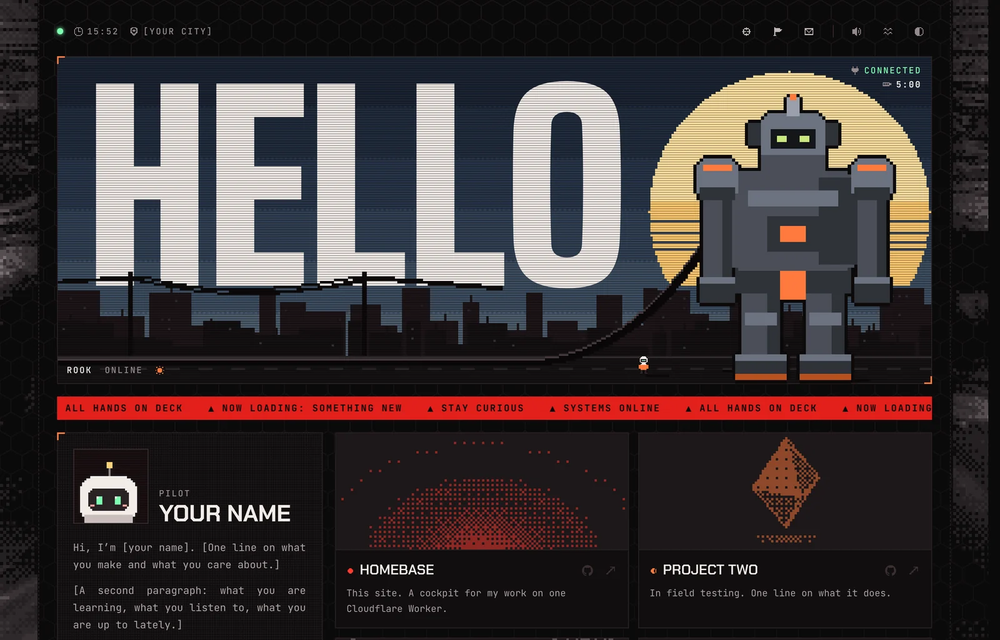
</picture>

</div>

这是 [asuki.cc](https://asuki.cc) 背后的框架，所有个人素材都已移除。让网站成为“你的”的一切，都放在一个文件夹 `persona/` 里。换掉这个文件夹，网站就变成你的：横幅里是你的机甲，警戒胶带上是你的宠物，播放的是你的音乐，写的是你的话。代码一行都不用改。

本 README 中的图片和 GIF 都录制自 [asuki.cc](https://asuki.cc)，也就是这个框架最初为之打造的网站：横幅里的 2 号机、警戒胶带上的像素明日香，以及卡西乌斯之枪。**这些角色不包含在模板中。** 模板自带一套原创的示例角色：机甲 **Rook**、宠物 **Bit**、一个小小的驾驶员和一支鱼叉，它们以 MIT 协议发布，你可以保留、改造或全部替换。这里展示的所有效果，换成任何 persona 都一样能用。

## 目录

- [包含什么](#包含什么)
- [功能一览](#功能一览)
- [用 AI 定制成你的主页](#用-ai-定制成你的主页)
- [手动定制](#手动定制)
- [在本地运行](#在本地运行)
- [部署到 Cloudflare](#部署到-cloudflare)
- [上线后修改内容](#上线后修改内容)
- [配置项一览](#配置项一览)
- [技术实现](#技术实现)
- [常见问题](#常见问题)
- [许可证](#许可证)

## 包含什么

<table>
<tr>
<td width="60%" valign="top">

- **会呼吸的横幅。** 一座像素城市，天空跟随你所在地真实的时间和天气变化：黎明、白天、黄昏、夜晚，还有雨、雾、雪和闪电。一台巨大的机甲站在街上，由一根电缆供电。
- **可以戳的东西。** 点击天空会升起护盾。拔掉电缆，机甲改用电池运行，驾驶员会跑过去把它插回去。鼠标移到机甲上，它的眼睛会亮。按住它两秒会打开彩蛋（如果你做了一个的话）。
- **页脚的宠物。** 它在警戒胶带上走来走去，盯着你的鼠标，喜欢被摸，摸过头会生气。把道具交给它，它会把道具沿着胶带扔出去。
- **完整的个人主页。** 带实时 GitHub 数据的个人面板、带程序生成像素机器的项目卡片、一整年的贡献图、里程碑、技术栈、音乐播放器，以及带实时数据的社交卡片。
- **物理模拟，而不是固定轨迹。** 弹簧、绳索和抛出的物体都是实时模拟的，所以每次的动作都不一样。
- **浅色和深色主题**，适配手机和电脑，支持减少动态效果，音效由程序合成，可以一键关闭。
- **快。** 页面在边缘节点渲染并缓存。GitHub 和天气数据每小时在后台刷新，访客不需要等待。

</td>
<td width="40%" valign="top" align="center">

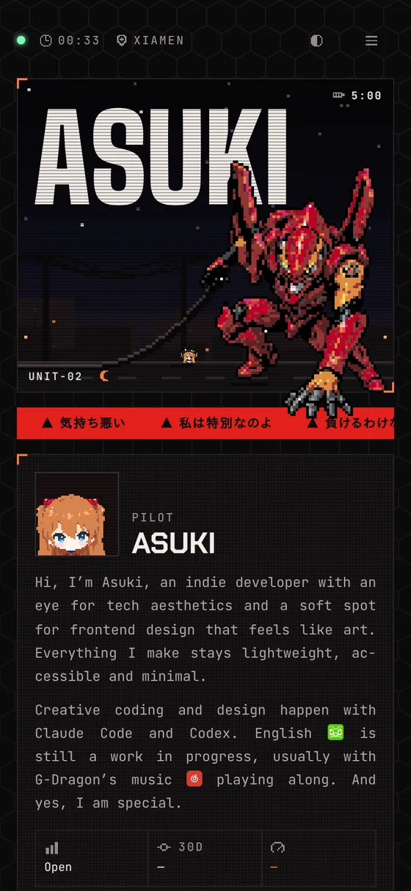 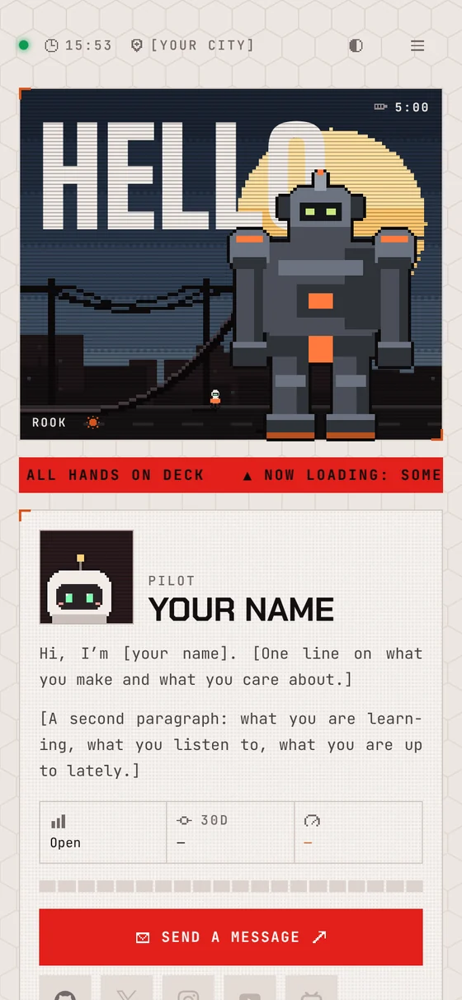

</td>
</tr>
</table>

## 功能一览

下面每个 GIF 都是网站的真实录屏，没有摆拍，也没有加速。

### 天空和你头顶的一样

填好你的经纬度，横幅就会显示你那里真实的天空：太阳的高度、一天中的时段和当前天气，数据来自 [Open-Meteo](https://open-meteo.com)（免费，无需密钥）。云、雨、雪、雾和闪电都画在和角色相同的像素网格里。

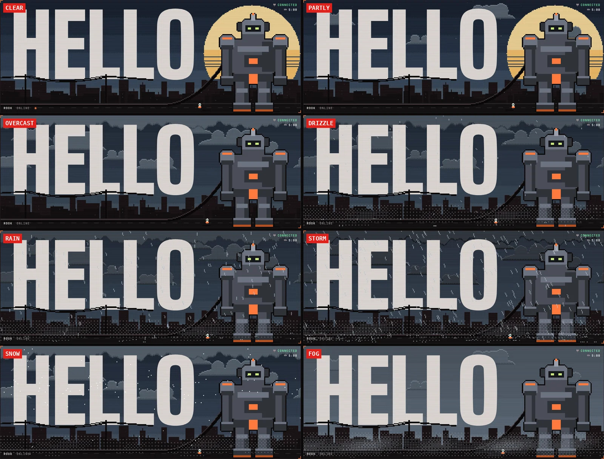

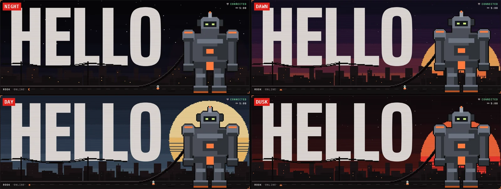

在网址后面加上 `?weather=rain` 可以预览任意天气（也可以是 `clear`、`partly`、`overcast`、`fog`、`drizzle`、`storm`、`snow`）。

### 页眉

页眉里的每个图标都有提示文字和各自的悬停、点击音效，按下时会像弹簧一样被压扁再弹回。海浪开关可以让两侧的海浪静止或重新涌动，喇叭开关会静音所有声音，包括音乐。

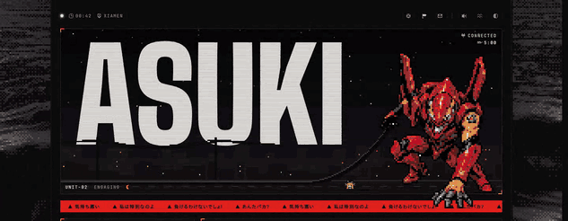

### 拔掉电缆

电缆是一根模拟的绳子。点击它，电缆就会脱落：机甲切换到五分钟的内置电池，状态栏随之变化，驾驶员会跑过去把插头用力插回去。连续拔三次，驾驶员就会闹脾气，电池可能会被耗光。

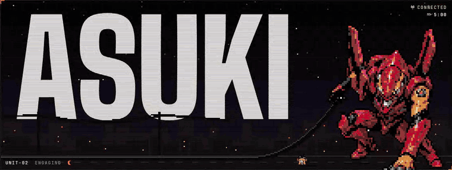

### 升起护盾

点击天空的任意位置，那里就会闪出一面护盾，并伴随音效。驾驶员会停下来抬头看。

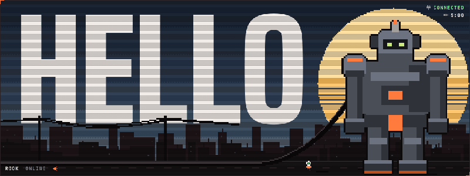

### 点亮它的眼睛

鼠标移到机甲上，它的眼睛会亮起来；点击它，眼睛会闪一下。

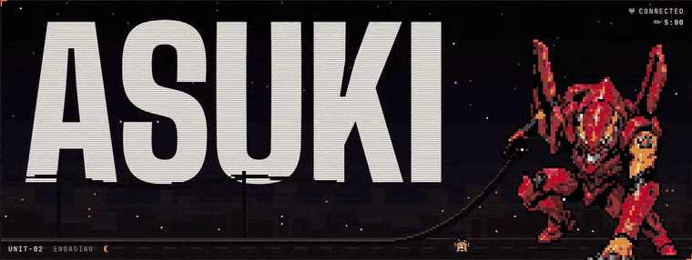

### 按住它，打开彩蛋

按住机甲两秒，它会朝你用力挣动，然后打开 persona 提供的彩蛋。在 asuki.cc 上是一个带音乐的 3D 场景；在你的 persona 里可以是任何东西，也可以没有。

<div align="center">

</div>

### 摸摸宠物

在宠物身上来回划动就是在摸它。它会回你一句台词，摸太久就会生气，最后转过身去闹别扭。

<div align="center">

</div>

### 把道具交给它

拿起道具丢到宠物身上（或者选中道具后按 Enter），它会举起道具、蓄力，然后沿着胶带扔出去。你也可以自己扔：道具像标枪一样飞行，保留你手上给它的旋转，最后枪头朝下插进胶带。

<div align="center">

</div>

### 翻转头像

点击头像，它会像一张装了弹簧的卡片一样翻过来，表面划过一道光。背面可以是任何图片。

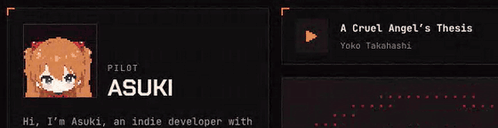

### 播放歌曲

一首歌，配一条像素波形，点击或拖动即可跳转。用 `track: null` 可以去掉它。

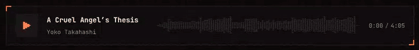

### 查看社交账号

鼠标移到社交图标上，会弹出该账号的卡片。配置了密钥或 feed 后，还会显示头像、数据和最新的一条内容。

<div align="center">
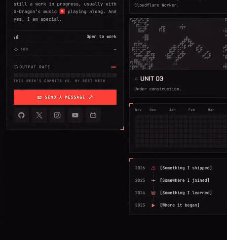
</div>

### 项目卡片

每张项目卡片里都有一台根据项目名生成的像素机器。鼠标移到卡片上，机器会转得更起劲。

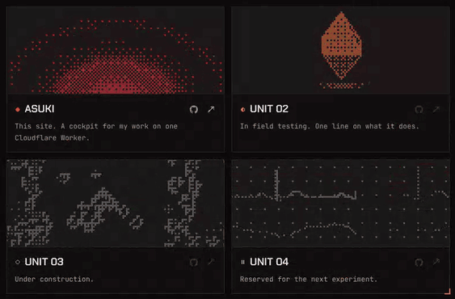

### 项目展示架

项目在单独的页面里打开：一排可以转动的展示盒，每个盒子里有一台根据项目名生成的像素机器。用方向键、滚轮或拖动来切换，按 Enter 取下一个盒子并播放它的视频。

<div align="center">

</div>

### 打开一个项目

从展示架上取下一个盒子，它就会打开：光盘滑出并就位，屏幕亮起，播放项目的视频。还没有视频时，屏幕会显示雪花和 NO SIGNAL。下方的链接通往源码和线上网站。

<div align="center">
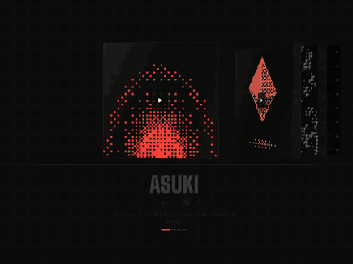
</div>

### 面板展开成页面

每个带橙色角标的面板都能展开成完整页面：项目、贡献、里程碑和技术栈。面板会长大铺满屏幕，主页在后面暗下去；按 Esc、点击返回角标或浏览器的后退按钮，页面会缩回原来的面板。每个页面都有自己的地址，比如 `/milestones`，可以直接分享链接。

<div align="center">
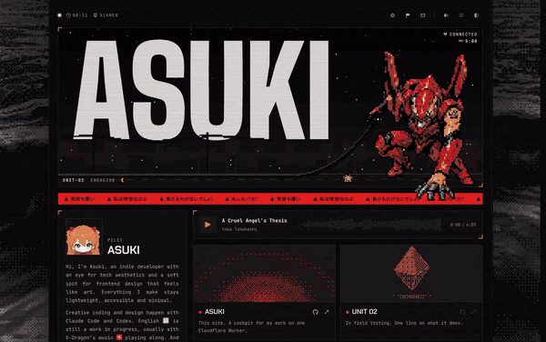
</div>

<div align="center">
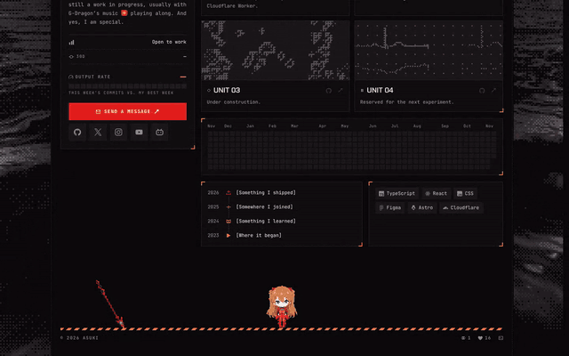
</div>

### 在手机上

在手机上，页眉会折叠成一个菜单，各个页面、横幅和宠物都可以用触摸操作。

<div align="center">
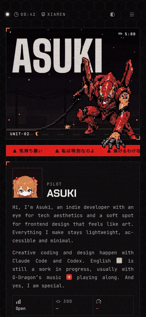
</div>

### 浅色和深色

切换主题时，新主题会扫过整个页面。两种主题都是专门设计的，不是简单的反色。

<div align="center">

</div>

<table>
<tr>
<td width="50%">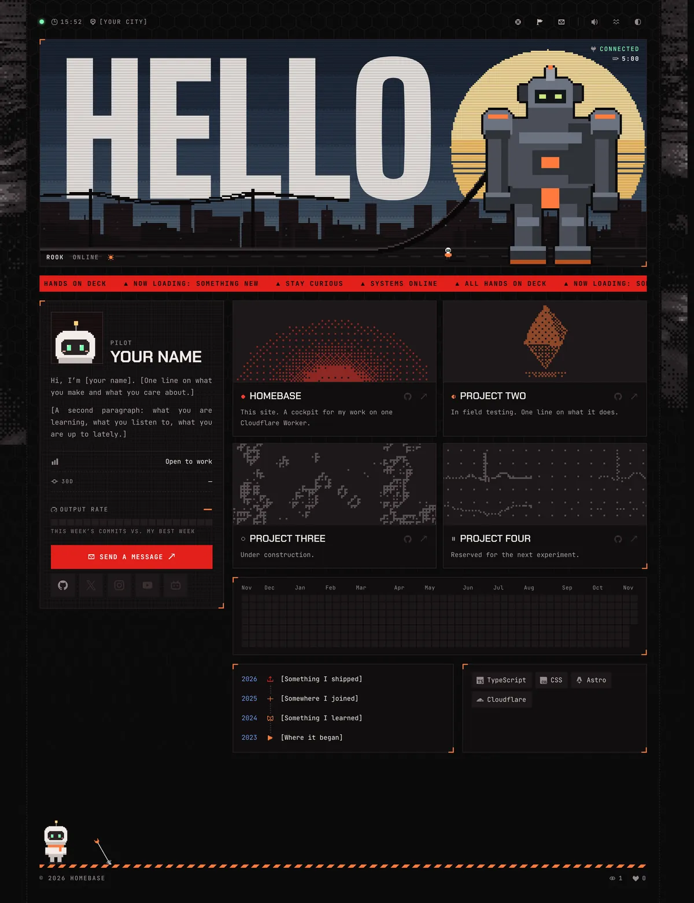</td>
<td width="50%">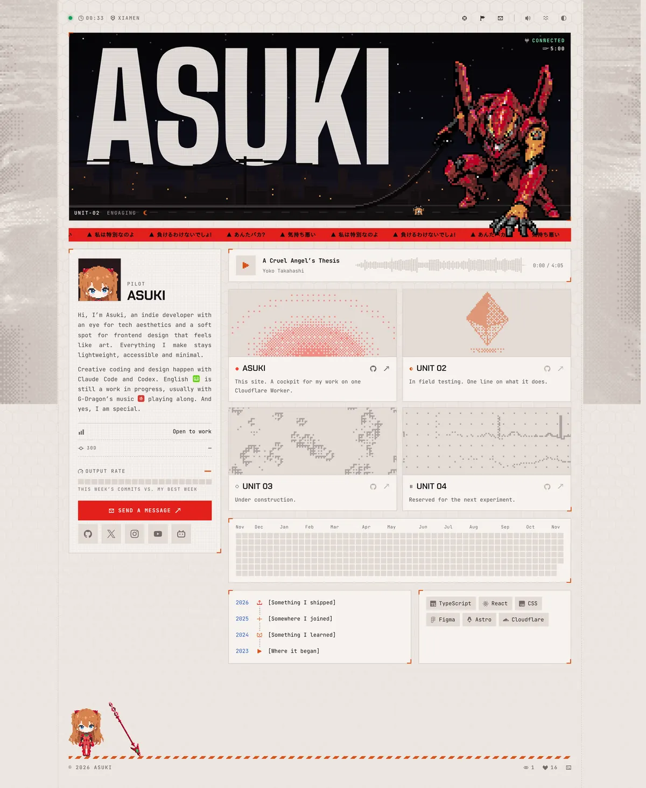</td>
</tr>
</table>

## 用 AI 定制成你的主页

框架本身从不提及任何角色、歌曲或人名，所以你可以把仓库交给 AI 编程助手（Claude Code、Codex、Cursor、Copilot、Windsurf 等），让它为你生成 persona，而代码保持不变。

仓库已经为此做好了准备：

| 文件 | 给 AI 提供了什么 |
|---|---|
| [`AGENTS.md`](AGENTS.md)（以及 `CLAUDE.md`） | 规则：只改 persona，不改框架；每次修改后运行检查；账号和密钥该放在哪里 |
| [`PERSONA.md`](PERSONA.md) | 精确的格式说明：精灵图的行、姿势名称、锚点、内容字段和长度限制 |
| `src/lib/persona.ts` | persona 的类型定义，每个字段都有注释 |
| `npm run check` | 校验器，用直白的话指出哪里错了 |

在 AI 助手里打开仓库，依次粘贴下面的提示词，把 `<尖括号>` 里的内容换成你自己的。提示词用中文写就可以。

**1. 创建你的 persona**

> 先读 AGENTS.md 和 PERSONA.md。把 persona/example 复制为 persona/&lt;我的名字&gt;，改成我的：网站名叫“&lt;名字&gt;”，横幅上写“&lt;单词&gt;”，我住在 &lt;城市&gt;，GitHub 用户名是 &lt;用户名&gt;。把我的位置和账号写进 wrangler.jsonc，把我的简介、项目和链接写进 content.ts。反复运行 npm run check 直到通过。

**2. 画出你的角色**

> 这是我的角色：&lt;附上图片&gt;。用它做一个像素风的宠物，大约 50 x 70 格，格式和 persona/example/sprites/pet.json 一样（调色板 + 行），包含 PET_FRAMES 里列出的每个姿势。然后为横幅做一台机甲（大约 70 x 100）和一个小驾驶员（大约 20 x 20）。每个调色板不超过 16 种颜色。根据新图更新锚点（feet、socket、shadows、eyes、hands、head），然后运行 npm run check。

下面是一个 persona 需要的全部美术素材，这里展示的是 asuki.cc 的（示例 persona 也为 Bit、Rook 和驾驶员准备了同样的一套）。AI 会为你的角色画出同样的一套：

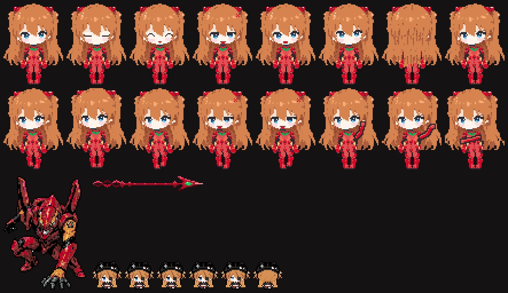

**3. 给它声音和颜色**

> 在 persona/&lt;名字&gt;/index.ts 和 content.ts 里写宠物的台词：害羞但骄傲。把界面用语改成 &lt;潜艇 / 飞船 / 蒸汽朋克&gt; 风格，并在 theme.css 里给网站换成 &lt;蓝色&gt; 主色，两种主题都要改。

**4. 加上音乐和音效（可选）**

> 把 persona/&lt;名字&gt;/public/music/&lt;文件&gt;.mp3 作为音乐播放器的曲目：对它运行 npm run peaks，把结果粘贴到 index.ts。用 persona/&lt;名字&gt;/public/sfx/&lt;文件&gt;.mp3 作为护盾音效。

**5. 加一个彩蛋（可选）**

> 为 persona/&lt;名字&gt; 做一个彩蛋：按住机甲两秒后，在页面上显示 &lt;你想要的内容&gt;。按照 PERSONA.md 里彩蛋一节的做法，保留 SSR 判断。

**6. 检查效果**

> 运行 npm run build 和 npm run preview，打开 http://localhost:8787，告诉我哪里看起来不对。

> [!TIP]
> AI 在网格上逐行绘制、使用小调色板、并且把每个姿势都当作在待机姿势上的小改动时，画得最好。AGENTS.md 已经告诉了它这些。如果你的 AI 能看图片，可以让它在完成前把精灵图渲染成 PNG 自己看一遍。

> [!IMPORTANT]
> 只使用你有权公开发布的美术、音乐和角色。框架本身不包含任何需要授权的内容；你放进 `persona/` 的东西由你自己负责。如果其中有只授权给你个人使用的内容，请把 persona 放在**私有**仓库里。

## 手动定制

一个 persona 就是一个文件夹：

```
persona/<name>/
  index.ts        名称、精灵图、界面用语、音乐、音效、彩蛋              （必需）
  content.ts      数据库的初始内容                                    （必需）
  theme.css       颜色覆盖，可以为空                                  （必需）
  sprites/        像素画，JSON 格式
  public/         放在网站根目录的文件：favicon.svg、img/、music/、sfx/
```

1. 把 `persona/example` 复制为 `persona/<name>`。只要除 `example` 外只有这一个文件夹，就会自动使用它。
2. 编辑 `index.ts`：`name`（网站名）、`title`（天空中的大字，5 到 6 个大写字母最合适）、`url`，以及各种名称和用语。
3. 编辑 `content.ts`：简介、状态、滚动条、项目、里程碑、技术栈、链接和宠物台词。
4. 用任意像素画软件（Aseprite、Piskel、LibreSprite、Photoshop）按一个像素一格绘制，导出 PNG 后转换：

   ```sh
   npm run sprite -- art/idle.png art/blink.png art/side.png --out persona/<name>/sprites/pet
   ```

   第一个文件成为精灵图本身，其余文件成为以文件名命名的姿势。如果是按 4 x 4 像素一格画的，加上 `--cell 4`。
5. 运行 `npm run check`。它会检查 [PERSONA.md](PERSONA.md) 里的每一条规则：行宽、颜色、姿势尺寸、锚点是否在图内、字段长度、文件是否存在，并告诉你要改什么，例如：

   ```
   persona: persona/bob
     ✗ mech.socket [90, 28] is outside the 64 x 96 sprite
     ✗ pet.frames.sideB: must be 40 x 54 cells like the sprite

   2 problem(s) to fix.
   ```

## 在本地运行

需要 [Node.js](https://nodejs.org) 22 或更高版本。

```sh
git clone https://github.com/<you>/<your-repo>.git
cd <your-repo>
npm install
cp .dev.vars.example .dev.vars   # 可选：填入 GITHUB_TOKEN 以显示真实的贡献图
npm run dev                      # 调样式最快，地址 http://localhost:4321
```

| 命令 | 作用 |
|---|---|
| `npm run dev` | 检查 persona，然后在 http://localhost:4321 启动开发服务器，编辑后页面自动刷新 |
| `npm run preview` | 构建后用本地 D1 数据库运行真实的 Worker，地址 http://localhost:8787。用它测试计数器、管理 API 和定时任务 |
| `npm run check` | 检查当前使用的 persona |
| `npm run build` | 检查后构建到 `dist/` |
| `npm run deploy` | 在你的电脑上构建并用 Wrangler 部署 |
| `npm run sprite -- <png...> --out <path>` | 把 PNG 转成精灵图 JSON |
| `npm run peaks -- <mp3>` | 输出音乐播放器的曲目配置和波形（需要 [ffmpeg](https://ffmpeg.org)） |

使用哪个 persona：设置了 `PERSONA=<name>` 就用它；否则用 `persona/` 里唯一不叫 `example` 的文件夹；都没有就用 `example`。有多个 persona 时，用 `PERSONA=<name> npm run dev` 指定。

## 部署到 Cloudflare

全部跑在 Cloudflare 的免费套餐上：一个 Worker 加一个 D1 数据库。

**1. 填写你的信息。** 在 `wrangler.jsonc` 里填好下面这些，然后推送到 GitHub：

- `name`：Worker 的名字，也是你的 `*.workers.dev` 子域名
- `GITHUB_USER`、`LOCATION_LABEL`、`TIMEZONE`、`LAT`、`LON`
- 想在卡片上显示的社交账号（见[配置项一览](#配置项一览)）

**2. 连接仓库。** 在 [Cloudflare 控制台](https://dash.cloudflare.com) 进入 Workers & Pages，点击 Create，再选 Import a repository，选择你的仓库。

- Build command：`npm run build`
- Deploy command：`npx wrangler deploy`
- Root directory：`/`

第一次部署会自动创建 D1 数据库。Worker 第一次运行时会自己建表并写入初始内容，不需要额外的迁移步骤。

**3. 添加密钥。** 在 Worker 的 Settings 里进入 Variables and Secrets，类型选 Secret：

| 密钥 | 用途 |
|---|---|
| `GITHUB_TOKEN` | 一个 [fine-grained token](https://github.com/settings/personal-access-tokens)，只给公开仓库的只读权限，不要其他权限。用来读取你的贡献日历。 |
| `VISIT_SALT` | 任意一串较长的随机字符，例如 `openssl rand -hex 32` 生成的。访客按加盐哈希每天只计一次，不保存任何 IP。 |
| `YOUTUBE_KEY` | 可选。只开启 YouTube Data API v3 的 Google Cloud API 密钥，用于 YouTube 卡片的订阅数。 |
| `INSTAGRAM_TOKEN` | 可选。不用 Behold 时用于 Instagram 卡片（见下文）。 |

**4. 绑定你的域名。** 域名接入你的 Cloudflare 账号后，取消 `wrangler.jsonc` 里 `routes` 的注释并推送。也可以在 Worker 的 Settings 里的 Domains & Routes 添加。

之后每次推送到默认分支都会自动重新构建和部署。每小时的定时任务（`7 * * * *`）会保持 GitHub 和天气数据的新鲜。

> [!NOTE]
> 普通变量写在 `wrangler.jsonc` 里。每次部署都会覆盖你在控制台里设置的普通变量，所以请在文件里修改。密钥不会被部署覆盖。

## 上线后修改内容

`content.ts` 只是初始内容。第一次运行之后，页面上的所有内容（简介、状态、滚动条、项目、里程碑、技术栈、链接和宠物台词）都存放在 D1 里，通过 `/admin/*` 管理 API 修改。它是为管理面板设计的，也可以直接用 `curl` 调用。

**用 Cloudflare Access 保护它。** 在 Zero Trust 里进入 Access，再进入 Applications，为你域名下的 `/admin` 路径添加一个 Self-hosted 应用，并添加一条只允许你自己邮箱的策略。然后把团队名（`<team>.cloudflareaccess.com` 里的 `<team>`）和应用的 Audience tag 分别填到 `wrangler.jsonc` 的 `ACCESS_TEAM` 和 `ACCESS_AUD`。Worker 自己也会校验 Access 签发的令牌，所以即使 Access 没配或配错，管理 API 也保持关闭。

| 方法 | 路径 | 作用 |
|---|---|---|
| GET | `/admin/manifest` | 所有集合、字段和操作。管理面板据此生成表单。 |
| GET | `/admin/c/:collection` | 列出记录（`?limit=` 最多 200，`?cursor=`） |
| GET | `/admin/c/:collection/:id` | 获取一条记录 |
| POST | `/admin/c/:collection` | 新建一条记录 |
| PATCH | `/admin/c/:collection/:id` | 修改一条记录。需带 `If-Match: <updated_at>`，如果别人先改过会返回 409。 |
| DELETE | `/admin/c/:collection/:id` | 删除一条记录，同样需要 `If-Match` |
| POST | `/admin/actions/:name` | `refresh-github`、`refresh-weather`、`reset-counter` |
| GET | `/admin/health`、`/admin/stats`、`/admin/audit` | 运行状态、统计数据、修改记录 |

```sh
# 本地：在 .dev.vars 里设置 ADMIN_DEV_BYPASS=1（仅对 localhost 生效）
curl localhost:8787/admin/c/missions

# 线上：使用 Access 服务令牌
curl https://example.com/admin/c/ticker \
  -H "CF-Access-Client-Id: $ID" -H "CF-Access-Client-Secret: $SECRET"
```

任何写入都会清除页面缓存，下次访问就能看到变化。公开接口有 `GET /api/now`（页面上的全部内容，JSON 格式）、`GET /api/github` 和 `GET /api/weather`。

## 配置项一览

以下都写在 `wrangler.jsonc` 的 `vars` 里。留空即隐藏对应的功能。

| 变量 | 示例 | 作用 |
|---|---|---|
| `GITHUB_USER` | `octocat` | 贡献图、提交数和产出速率 |
| `LOCATION_LABEL` | `Shanghai` | 页眉显示的城市 |
| `TIMEZONE` | `Asia/Shanghai` | 时钟和一天中的时段（[IANA 时区名](https://en.wikipedia.org/wiki/List_of_tz_database_time_zones)） |
| `LAT`、`LON` | `31.23`、`121.47` | 横幅的太阳、天空和天气 |
| `X_USER` | `jack` | X 卡片（通过 FxTwitter 读取，无需密钥） |
| `YOUTUBE_HANDLE` | `veritasium` | YouTube 卡片（`@` 后面的名字） |
| `BILIBILI_UID` | `2` | 哔哩哔哩卡片（`space.bilibili.com/<uid>` 里的数字） |
| `BEHOLD_FEED` | | Instagram 卡片，通过免费的 [Behold](https://behold.so) JSON feed |
| `DUOLINGO_USER`、`NETEASE_ID` | | 简介里的应用图标（`{duolingo}`、`{netease}`），悬停时显示连胜天数和等级 |
| `ACCESS_TEAM`、`ACCESS_AUD` | | 保护 `/admin/*` 的 Cloudflare Access |

## 技术实现

```
persona/
  example/              模板自带的 persona：Bit、Rook 和鱼叉。复制它。
    index.ts            名称、精灵图、界面用语、音乐、音效、彩蛋
    content.ts          初始的简介、项目、链接、滚动条和宠物台词
    theme.css           颜色覆盖
    sprites/            调色板 + 行格式的像素画
    public/             网站图标、图片、音乐、音效
src/
  pages/index.astro     页面
  components/           横幅、个人面板、模块、子页面和页脚
  scripts/              浏览器端：小型状态机、弹簧、绳索、画布
  lib/persona.ts        persona 的类型：一个 persona 必须提供什么
  lib/scene.ts          在渲染时把横幅城市和精灵图生成 SVG
  styles/               设计变量和网站样式，两种主题
  server/               D1 表结构、GitHub 和天气快照、公开 API 和管理 API
  worker.ts             Worker 入口：路由、页面缓存、每小时定时任务
scripts/                check-persona、sprite-from-png、peaks 和构建辅助脚本
```

- **[Astro](https://astro.build)** 在一个 **Cloudflare Worker** 上渲染页面，内容和计数器存在 **D1** 里。
- **客户端没有框架。** 每个交互都是一个小型 TypeScript 状态机，只在出现在屏幕上时运行。
- **精灵图就是数据。** 每张精灵图都是若干行字符加一张颜色表，在服务端画成 SVG，任何尺寸下都清晰，也不产生额外的图片请求。
- **输入 persona，输出网站。** Vite 把 `@persona` 指向当前使用的 persona 文件夹，并以它的 `public/` 作为静态目录。`src/` 里没有任何角色的名字。

## 常见问题

<details>
<summary><b>需要会写代码吗？</b></summary>

不太需要。用 AI 助手的话，你只要描述想要什么，然后运行它让你运行的命令。你需要一个 GitHub 账号和一个 Cloudflare 账号，都是免费的。

</details>

<details>
<summary><b>可以去掉一些功能吗？</b></summary>

可以。`track: null` 去掉音乐播放器，`prop: null` 去掉宠物的道具，`egg: null` 去掉彩蛋，账号变量留空则隐藏对应的卡片或图标。

</details>

<details>
<summary><b>我改了 content.ts，线上网站没变化。</b></summary>

这是正常的：`content.ts` 只用于初始化新数据库。线上内容请通过管理 API 修改，或者在 Cloudflare 控制台的 D1 控制台里修改。

</details>

<details>
<summary><b>贡献图是空的。</b></summary>

设置 `GITHUB_USER` 并添加 `GITHUB_TOKEN` 密钥，然后调用 `POST /admin/actions/refresh-github`，或者等待每小时的定时任务。

</details>

<details>
<summary><b>框架更新了，我怎么同步？</b></summary>

把本仓库添加为远程仓库（`git remote add upstream https://github.com/K1nesss/asuki-template.git`），时不时合并一下 `upstream/main`。你的 persona 文件夹不会产生冲突，因为框架从不修改它。

</details>

## 许可证

代码采用 [MIT](LICENSE) 协议。示例 persona（Bit、Rook、驾驶员、鱼叉和网站图标）是原创的，采用相同协议，你可以随意复用或改造。`docs/` 里的图片展示的是 asuki.cc。其中的角色（明日香、2 号机和卡西乌斯之枪）不在 MIT 协议范围内，也不属于模板，请不要复用。
